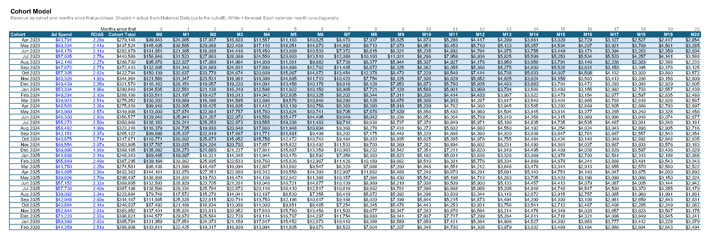
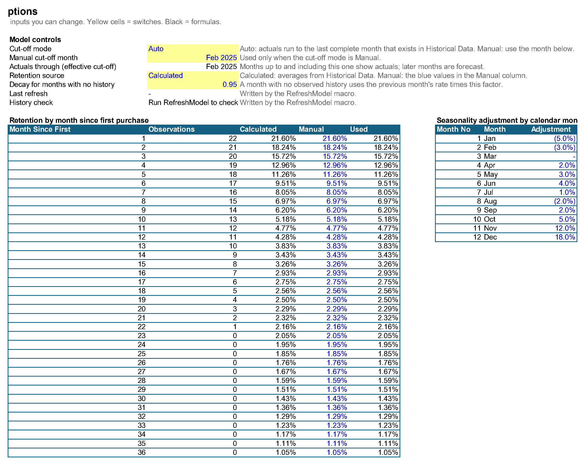
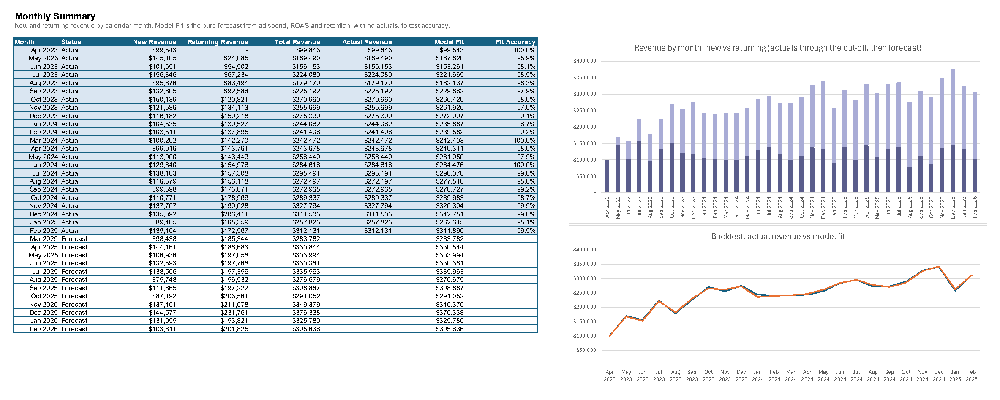

# Cohort Revenue Forecast in Excel and VBA

An Excel model that forecasts e-commerce revenue by customer cohort, mixing actuals with forecasts, with VBA that refreshes the model and checks its data every time the workbook opens.

It recreates a model I built for a client in Excel with VBA. The company here, Lumora Goods, is fictional, and every number is synthetic.

**[Download the workbook](Lumora_Cohort_Revenue_Model.xlsx)** · **[VBA module](vba/CohortRefresh.bas)**



## What it answers

- How much revenue will each monthly customer cohort bring in, from its first purchase through month 36?
- How much of each month's revenue comes from new customers and how much from returning ones?
- How accurate is the forecast when tested against months we already have actuals for?

## How the model works

1. **New-customer revenue** for a cohort is ad spend × ROAS.
2. **Returning revenue** in month *k* is the cohort's first-month revenue × the retention rate for month *k* × (1 + that calendar month's seasonality).
3. **Retention rates** are averages from Historical Data. Each historical value is divided by its month's seasonality first, so seasonality is removed before averaging and added back once in the forecast. That avoids counting it twice.
4. **Actuals override forecasts.** Every cell up to the cut-off month that exists in Historical Data shows the actual value. Later cells are forecast. In the grid, each calendar month runs diagonally.
5. **Months with no history** use the previous month's retention × a decay factor (0.95 by default).

## Sheets

| Sheet | What it holds |
|---|---|
| Read Me | Purpose, data flow, monthly update steps, how to extend the model, colour key |
| Assumptions | Cut-off switch, retention-source switch, decay factor, retention table (months 1–36), seasonality table |
| Cohort Model | 35 cohorts × months 0–36 since first purchase. Shaded cells are actuals |
| Monthly Summary | New, returning and total revenue by month, actuals, the backtest, and two charts |
| Historical Data | Actual revenue by cohort and order month, with a check column for bad rows |



## Switches

| Switch | Options | What it does |
|---|---|---|
| Cut-off mode | Auto / Manual | Auto: actuals run to the last complete month that exists in Historical Data. Manual: you pick the month |
| Retention source | Calculated / Manual | Use the historical averages, or the rates you type into the Manual column |

## Backtest

Model Fit is a pure forecast: ad spend × ROAS for new revenue, then retention and seasonality, with no actuals at all. Compared with the 23 months of actuals, it averages **98.8% accuracy** (lowest month 96.7%).



## VBA

The module [`vba/CohortRefresh.bas`](vba/CohortRefresh.bas) has three macros:

| Macro | What it does |
|---|---|
| `Auto_Open` | Runs when the workbook opens and calls `RefreshModel` |
| `RefreshModel` | Recalculates the model, checks Historical Data for duplicate rows, month mismatches and blank revenue, and writes the result and the refresh time to the Assumptions sheet |
| `AddNextCohort` | Adds the month after the last cohort as a new row and puts the cursor on its Ad Spend cell |

To install it once: open the workbook, press **Alt+F11**, choose **File > Import File**, pick `CohortRefresh.bas`, then save the workbook as **.xlsm**.

```vba
Public Sub Auto_Open()
    RefreshModel
End Sub

Public Sub RefreshModel()
    Dim issues As String
    On Error GoTo Failed
    Application.ScreenUpdating = False
    Application.CalculateFull
    issues = CheckHistory()
    With ThisWorkbook.Worksheets("Assumptions")
        .Range("LastRefresh").Value = Now
        If Len(issues) = 0 Then
            .Range("HistoryStatus").Value = "OK: no duplicates, month mismatches or blanks"
        Else
            .Range("HistoryStatus").Value = issues
        End If
    End With
    Application.ScreenUpdating = True
    Exit Sub
Failed:
    Application.ScreenUpdating = True
    MsgBox "Refresh stopped: " & Err.Description, vbExclamation, "Cohort model"
End Sub
```

`CheckHistory` walks the Historical Data table with a dictionary keyed on cohort and month to find duplicates, and reads the table's own check column for month mismatches. The full module is in [`vba/CohortRefresh.bas`](vba/CohortRefresh.bas).

## Every month

1. Paste the new month's actual rows under the Historical Data table. The table grows, and every formula picks the rows up.
2. With the cut-off on Auto, actuals extend to the new month by themselves.
3. Enter the next cohort's ad spend and ROAS, or run `AddNextCohort`.

## Built with

Excel tables and structured references, `SUMIFS`, `COUNTIFS`, `AVERAGEIFS`, `INDEX`, `EDATE`, `SUMPRODUCT` over a two-dimensional grid, data-validation switches, formula-driven conditional formatting, named ranges, and VBA.

## Checks

The workbook was recalculated in Excel and checked:

- no formula returns an error
- in all 23 actual months, the model's monthly total equals the actual revenue exactly
- switching to a Manual cut-off of December 2024 moves actuals back to 21 months
- switching the retention source to Manual changes the forecast to the typed rates
- a new cohort row fills in every formula on its own
- the history check column reports no problem rows

All data in this repository is synthetic. Lumora Goods is a fictional company.
